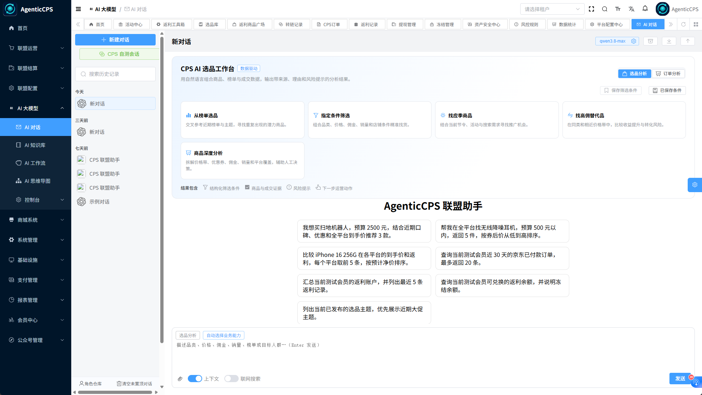
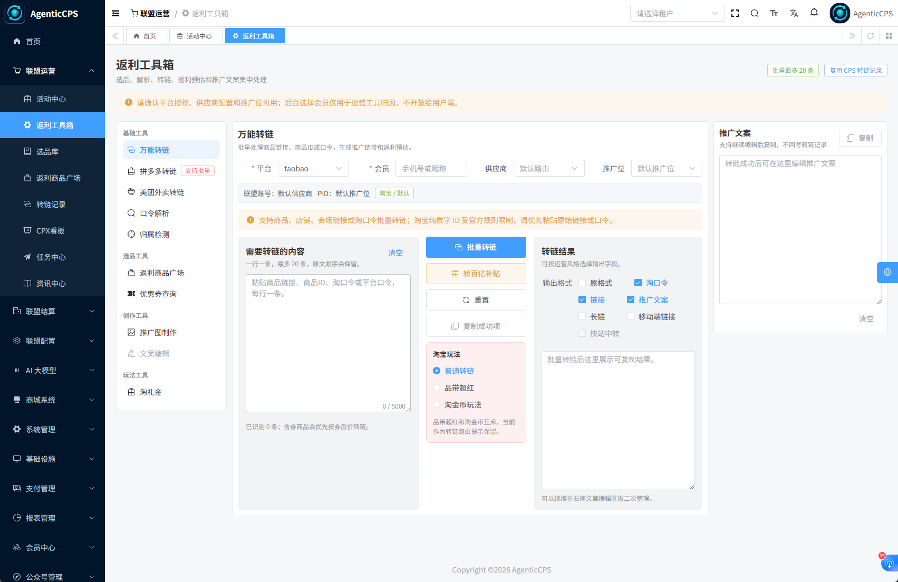
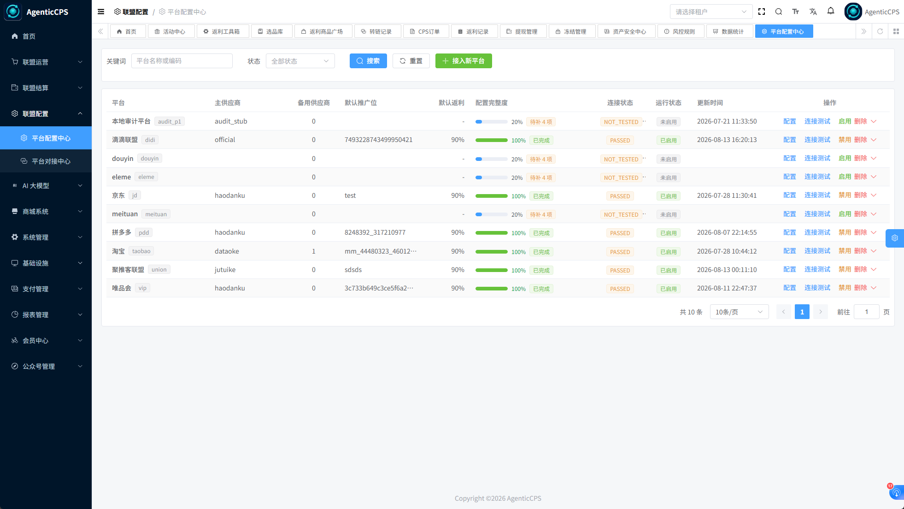
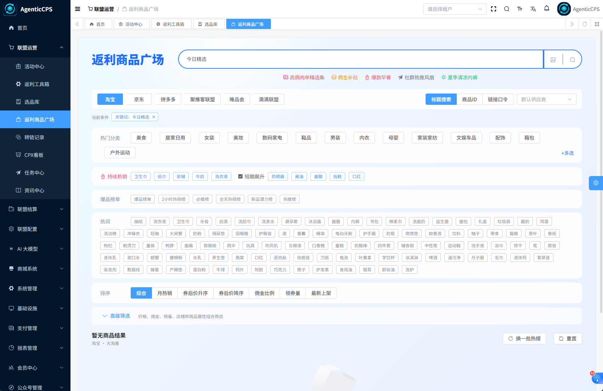
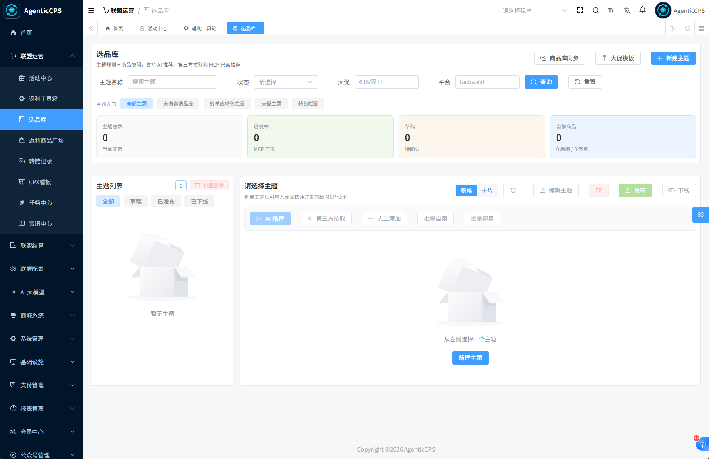
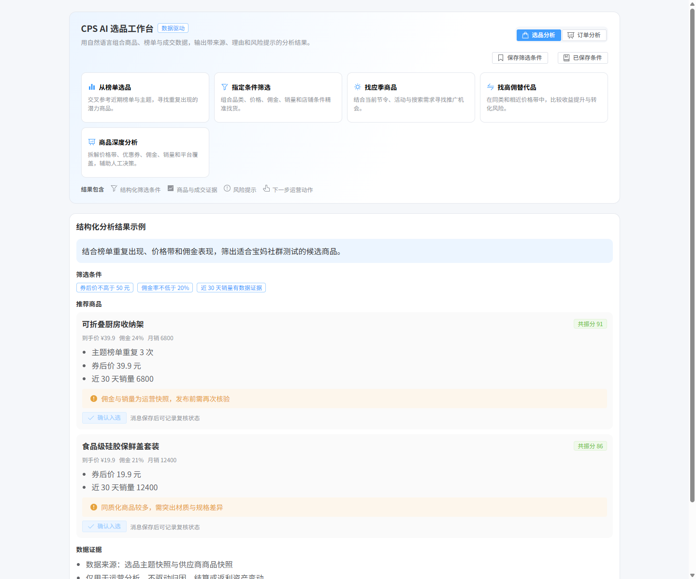
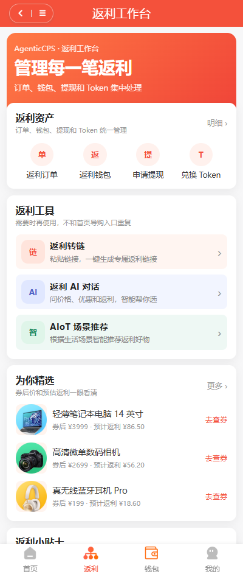
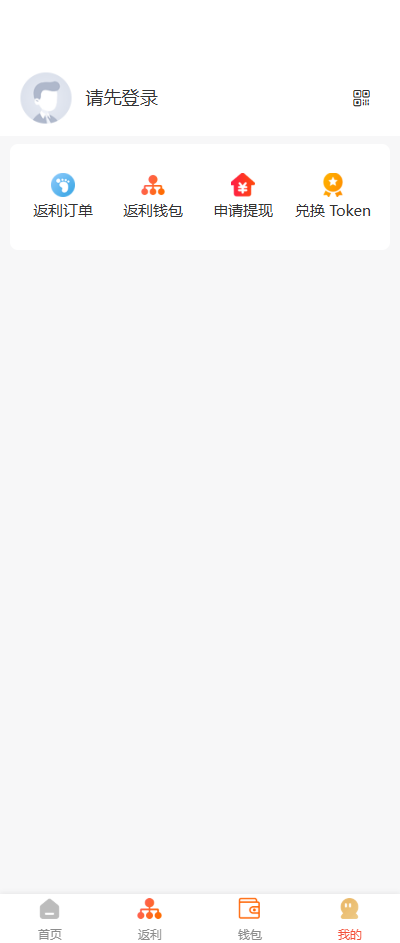

<p align="center">
  
  
  
  
  
</p>

<h1 align="center">AgenticCPS</h1>

<p align="center">
  面向一人公司和小团队的 CPS 联盟返利与智能导购平台<br/>
  聚合商品、优惠、推广、订单和返利资产，让运营与 AI Agent 共用一套能力底座
</p>

> 代码仓库：[Gitee](https://gitee.com/zhuangpengli/AgenticCPS) · [GitCode](https://gitcode.com/lizhuangpeng/AgenticCPS) · [GitHub](https://github.com/zhuangpengLI/AgenticCPS)

快速部署请先阅读 [快速开始](./docs/快速开始.md)；模块位置和接口入口见 [项目地图](./docs/project-map.md)。

## 🌐 在线演示

欢迎在线体验 AgenticCPS 系统的完整功能：

| 平台端 | 演示入口 | 说明 |
| :--- | :--- | :--- |
| 💻 **管理后台** | [http://106.75.236.70/index](http://106.75.236.70/index) | 支持电脑端访问，体验平台配置中心、返利工具箱、选品库、运营工作台等完整后台功能 |
| 📱 **移动端 (H5)** | [http://106.75.236.70/h5/](http://106.75.236.70/h5/) | 支持手机浏览器直接访问/扫码，或电脑端使用 F12 移动端模式体验查券转链与返利商城 |

> 💡 **提示**：演示环境为沙箱测试数据，将定期清理与重置，请勿录入真实生产密钥。

## 📢 广告位与商务合作

本项目面向独立开发者、一人公司、CPS 淘客联盟运营与 AI Agent 创业团队，具备高粘性的精准受众群体。现开放核心广告位与合作通道，支持**资源互换**、**广告位合作**以及**付费广告位**等多种形式：

<p align="center">
  <a href="#交流社区"></a>
  <a href="#交流社区"></a>
  <a href="#交流社区"></a>
</p>

| 广告位 | 合作类型 | 展示形式与位置 | 适用对象 | 状态 |
| :--- | :--- | :--- | :--- | :--- |
| **🥇 黄金横幅广告位** | 付费广告位 | README 顶部黄金区域 / 显眼横幅展示 | 云厂商、大模型与 API、开发工具、出海服务、电商 SaaS 等 | 🟢 [虚位以待 · 欢迎洽谈](#交流社区) |
| **🚀 核心功能推荐位** | 广告位合作 | 核心功能区推荐卡片 / 推荐解决方案 | CPS 联盟平台、选品平台、供应链服务商、生态合作方等 | 🟢 [虚位以待 · 欢迎洽谈](#交流社区) |
| **🤝 开发者生态友链** | 资源互换 | 开源生态互推 / 友情链接互换 | 优质开源项目、技术社区、技术博客互相引流与推广 | 🟢 [虚位以待 · 申请互换](#交流社区) |
| **📱 演示站点展示位** | 付费/赞助合作 | 在线演示后台与 H5 移动端体验页面曝光 | 面向实际体验系统用户的直达转化推荐位 | 🟢 [虚位以待 · 欢迎洽谈](#交流社区) |

> 💬 **合作咨询**：欢迎添加微信（备注：`广告合作` 或 `资源互换`）交流对接，详见文末 [交流社区](#交流社区)。

## 项目定位

AgenticCPS 是 Agentic 生态中的 CPS 返利与商品推荐服务，覆盖“选品 → 搜索/比价 → 转链 → 下单 → 订单同步 → 返利结算 → 提现/Token 消费”的完整链路。它既可以作为独立的返利商城后端，也可以作为 AI 导购、活动运营和其他 Agent 场景的商品与返利服务。

项目与其他 Agentic 系统保持清晰边界：

| 系统 | 负责什么 | 不负责什么 |
| --- | --- | --- |
| **AgenticCPS** | CPS 平台适配、商品推荐、订单归因、返利结算、返利资产和 CPS MCP Tools | 大模型网关、Token 主账本、设备接入与 IoT 规则 |
| **AgenticTokenHub** | 模型网关、Token 钱包与计费、会员套餐、返利兑换 Token 的入账 | CPS 订单、商品推荐和返利结算 |
| **AgenticAIoT** | 设备、指标、告警、规则和 AI 运维，并触发场景化商品推荐 | CPS 返利账户和电商平台适配 |

当前已落地的生态闭环是：可用 CPS 返利经过冻结、扣减、幂等和审计后兑换为 AgenticTokenHub 的 AI Token；失败解冻，超时进入可补偿的处理中状态。详见 [返利兑换 Token 说明](./docs/agentic-ecosystem-p0-rebate-token-exchange.md)。

## AI 编程与 Vibe Coding

AgenticCPS 适合用 AI 编程（AI-assisted coding）和 Vibe Coding 的方式快速迭代：先用自然语言描述业务目标，再让 Agent 检索项目地图、接口契约和现有实现，生成小步可审查的改动，最后用自动化测试和人工验收闭环。

推荐协作节奏：

1. **先说清结果**：描述用户场景、输入输出、边界条件和验收标准。
2. **让 AI 先读后改**：优先复用现有模块、Service、MCP Tool 和前端组件，避免重复造轮子。
3. **小步提交**：每次只处理一个功能点，保留可回滚的 diff，并补充必要的单元测试、接口测试或 Playwright 用例。
4. **人机共同验收**：AI 负责检索、实现和初步验证，维护者负责业务、资金安全、隐私和上线风险判断。

项目已提供 [Codex / TDD / E2E 开发流程](./docs/codex-agentic-development-workflow.md)。欢迎提交你的 Prompt、工作流和 Vibe Coding 案例，让更多人用一人团队完成可维护的 CPS 产品。

例如，可以从这样的需求开始：

> 为 AI 购物助手增加“按预算推荐”能力。先阅读项目地图与现有搜索、比价、转链工具，复用已有接口；列出需要修改的文件与验收标准，补充最小测试后实现，并报告验证结果。

## 核心功能

### 多平台商品与推广

- 统一接入淘宝、京东、拼多多、抖音、美团、唯品会、淘宝闪购等平台，并提供大淘客、好单库、聚推客、喵有卷、实惠猪及官方 API 适配器。
- 支持商品搜索、热搜与联想、链接/口令解析、商品详情、优惠券查询、跨平台比价和统一字段返回。
- 支持长链、短链、口令、H5/小程序等推广形式；平台、供应商、推广位和返利规则可插拔扩展。
- 通过平台配置中心完成“平台信息 → 供应商 → 推广位 → 返利配置 → 检测发布”五步配置，检测通过后才切换运行配置。

### 运营选品与营销工具

- **活动中心**：配置 CPS/CPA 活动卡片，支持热门/最新、搜索和商品广场跳转。
- **返利工具箱**：万能转链、口令解析、归属检测、优惠券查询、批量转链、淘礼金计划和推广文案编辑。
- **选品库与 AI 选品工作台**：自定义主题、第三方同步、大促模板、商品快照、AI 筛选条件保存与复用。
- **榜单与专区**：爆款榜、主播销量榜、9.9 包邮、博主橱窗等可配置货架，可被前端和 MCP 查询。
- **营销数据层**：商品主档、来源映射、价格快照、券池、自有短链、点击事件和基础漏斗分析，服务展示、分发与运营分析，不替代结算事实。

### 订单、返利与资金安全

- 订单状态覆盖已下单、已付款、已收货、已结算、已入账及退款/失效分支，保留状态事件、同步 checkpoint 和失败补偿记录。
- 归因记录 `externalId`、`relationId/channelId`、`specialId`、专属 PID 等来源证据；未验证映射的订单只进入对账/人工申领，不自动修改会员资产。
- 支持会员订单查询、订单号申领与管理员审核；会员端只使用登录上下文，避免信任请求体中的 `memberId/userId`。
- 返利账户、冻结/解冻、确认扣减、退款欠款和 Token 兑换统一写入资产台账，具备幂等键、租户隔离、操作审计和可追踪资金流水。
- 支持返利提现、转账记录、风控规则、退款报表和订单资金追踪；金额按分存储，敏感凭证统一加密。

### CPX 任务与增长分析

- 提供 CPS 优先的 CPX 任务大厅、任务详情、Tracking Link、转化查询和资讯/教程内容。
- 管理端支持任务、素材、平台资料、转化事件、结算记录和漏斗看板；OpenAPI 支持曝光、点击、线索、动作/转化事件上报。
- 提供增长分析、渠道/活动漏斗、风险监控、实验分流和 Token 事件对账能力，便于持续运营和归因复盘。

### MCP / Agent 原生能力

内置 Spring AI MCP Server，将 CPS 能力以结构化工具开放给 AI Agent：

| 能力组 | 工具示例 |
| --- | --- |
| 商品与推广 | `cps_search_goods`、`cps_compare_prices`、`cps_generate_link` |
| 订单与返利 | `cps_query_orders`、`cps_get_rebate_summary`、`cps_explain_rebate` |
| 选品与决策 | `cps_recommend_by_scene`、`cps_list_selection_themes`、`cps_recommend_from_selection_theme`、`cps_purchase_decision` |
| 营销策略 | `cps_promotion_strategy_advice`、商品深度分析、成交画像与趋势分析工具 |
| 资产与生态 | `cps_get_rebate_balance`、`cps_create_token_exchange`、`cps_query_exchange_status` |
| CPX | `cpx_list_tasks`、`cpx_get_task_detail`、`cpx_generate_tracking_link`、`cpx_query_conversions`、`cpx_recommend_tasks_by_scene`、`cpx_search_articles` |

新增工具需要同步回调注册、风险清单、AI 工具种子 SQL 和结构化消息解析器。MCP 会员资产工具只接受可信的登录或 ToolContext 会员上下文，并记录访问审计。


## 🔌 支持平台与准入指南

AgenticCPS 采用 **“平台适配器（Platform Adapter）+ 供应商客户端（Vendor Client）”** 双层解耦架构，支持**官方开放平台直连**与**第三方聚合服务商**双通道自由切换。系统已完成各大主流电商与本地生活出行平台的适配，覆盖选品搜索、转链推广、订单增量同步与返利结算全链路。

### 1. 全平台支持矩阵与准入要求总览

| 平台 / 渠道 | 平台标识 | 接入渠道类型 | 系统支持情况 | 平台注册 / 控制台地址 | 申请资质与准入门槛要求 | 支持功能范围 | 接入与配置指引 |
| :--- | :--- | :--- | :--- | :--- | :--- | :--- | :--- |
| **京东联盟官方** | `jd` | 官方直连 (JOS SDK) | ✅ 原生支持 | [京东联盟](https://union.jd.com/) · [JOS开放平台](https://open.jd.com/) | 支持企业或个人实名认证；须具备工信部备案网站、已上架 App 或媒体渠道资产，审核通过后获取 AppKey/Secret | 搜索、京粉精选、猜你喜欢、三模式转链、订单明细、礼金订单、远程 PID 与渠道关系管理 | [集成指南](./docs/jd-official-api-integration.md) |
| **淘宝联盟官方** | `taobao` | 官方直连 (TOP OpenAPI) | ✅ 原生支持 | [阿里妈妈·淘宝联盟](https://pub.alimama.com/) · [淘宝开放平台](https://open.taobao.com/) | 阿里妈妈实名账户；具备 ICP 备案网站、已上架 App 或认证小程序等媒体资质；高阶渠道管理接口需企业法人资质 | 物料搜索、淘口令生成、高佣转链、增量订单同步、渠道关系管理（RID / SID 精细化归因） | [归因说明](./docs/dataoke-high-efficiency-link-attribution.md) |
| **唯品会官方** | `vip` | 官方直连 (VOP SDK 2.0) | ✅ 原生支持 | [唯品会联盟](https://union.vip.com/) · [唯品会开放平台 (VOP)](https://vop.vip.com/) | 支持个人或企业申请；实名入驻开发者中心创建应用，内置 HMAC-MD5 协议与 SDK，无硬性保证金要求 | 品牌特卖商品搜索与详情、单品及活动高佣转链、实时订单同步与售后退款追踪、推广位管理 | 官方 SDK 内置直连 |
| **拼多多官方** | `pdd` | 官方直连 (多多客 DDK) | ✅ 原生支持 | [多多进宝](https://jinbao.pinduoduo.com/) · [多多客开放平台](https://open.pinduoduo.com/) | ⚠️ **需申请并缴纳保证金**：需提交企业或个体工商户资质及推广场景审核，并根据权限包缴纳平台风险保证金 | 商品搜索、多多客转链、增量订单拉取、主题频道推广（支持配置好单库/大淘客免保证金代理） | 官方 DDK 规范直连 |
| **抖音官方百应** | `douyin` | 官方直连 (巨量百应/抖客) | ✅ 原生支持 | [巨量百应](https://buyin.jinritemai.com/) · [抖店开放平台](https://op.jinritemai.com/) | ⚠️ **准入门槛极高**：仅限企业法人；**硬性软著一致**（软著主体与企业完全一致）、同主体 ICP 备案、系统功能说明书与百应机构认证 | 精选联盟检索、抖客官方高佣转链、抖音口令/Zlink 生成、全渠道推广订单与分账同步 | [百应指南](./docs/douyin-official-api-integration.md) |
| **抖音穿山甲联盟** | `douyin` | 官方聚合 (CSJ Pangolin) | ✅ 原生支持 | [穿山甲媒体管理平台](https://www.csjplatform.com/) | ⚠️ **API需达标才能开通**：实名开通订单查询；转链/搜索受准入保护，需提供主流应用市场在架证明或签署《媒体流量备案登记表》并提交流量评估；退款率 $\le 40\%$ | 穿山甲商品检索(`/product/search`)、高佣转链(`/product/link`)、28733协议订单明细(`/order/search`) | [穿山甲指南](./docs/douyin-csj-api-integration.md) |
| **美团联盟官方** | `meituan` | 官方直连 (Shepherd Gateway) | ✅ 原生支持 | [美团联盟媒体平台](https://media.meituan.com/) · [美团开放平台](https://openapi.meituan.com/) | 需企业法人营业执照；媒体资产资质备案（自有 App 须软著+应用市场上架证明+App ICP；小程序/公众号需认证）；具备开票资质 | 外卖/闪购/到店卡券与商品选品、自动化转链、Deeplink/小程序唤起、增量订单同步与佣金结算 | [美团指南](./docs/meituan-official-api-integration.md) |
| **淘宝闪购联盟** | `eleme` | 官方直连 (TOP OpenAPI) | ✅ 原生支持 | [淘宝开放平台 (TOP)](https://open.taobao.com/) · [阿里妈妈](https://pub.alimama.com/) | 企业法人执照、实名认证淘宝账号、企业对公账户；开通“阿里本地生活媒体分销”商业权限包 | 闪购官方活动转链(天天领红包)、商户单店选品推广、正向分销订单同步、SID精细会员返利归因 | [闪购指南](./docs/taobao-shangou-official-api-integration.md) |
| **滴滴出行联盟** | `didi` | 官方直连 (DUnion SDK) | ✅ 原生支持 | [滴滴出行联盟 (DUnion)](https://union.didi.cn/) | 支持个人与企业注册；创建媒体渠道并申请推广位 ID，获取官方 App-Key 和 accessKey 签名密钥即可调用 | 打车/加油/代驾活动转链、小程序路径/码生成、推广海报、订单增量同步与归因核销 | [滴滴指南](./docs/didi-union-sdk-usage-configuration.md) |
| **同程旅行联盟** | `tongcheng` | 定向对接 / 聚合接入 | ✅ 支持接入 | [同程分销联盟](https://union.ly.com/) · [同程开放平台](https://open.ly.com/) | ⚠️ **需单独申请且名额审核严格**：开放申请的接口较少，需人工审核业务场景与预估出票量后定向开通；中小型开发者推荐走聚推客免审接入 | 机票、火车票、酒店、景区门票等文旅出行活动推广、转链分销与订单佣金结算 | 支持定向/聚推客代理 |
| **大淘客开放平台** | `dataoke` | 第三方综合聚合 | ✅ 原生支持 | [大淘客开放平台](https://openapi.dataoke.com/) | 🟢 **零门槛开箱即用**：个人/企业均可免费入驻，实名认证后创建应用即获 AppKey/AppSecret，无软著、无保证金要求 | 淘宝/天猫超选库、热搜词联想、销量榜/爆款榜、高效转链、增量订单同步、活动列表；兼顾京东/拼多多搜索 | [大淘客指南](./docs/dataoke-high-efficiency-link-attribution.md) |
| **好单库开放平台** | `haodanku` | 第三方综合聚合 | ✅ 原生支持 | [好单库开放平台](https://www.haodanku.com/openapi/) | 🟢 **低门槛友好**：支持个人/企业注册，实名申请 APIKey 无需软著；京东转链填 unionId 与三段式 PID；公共池搜索免配账号 | 淘宝/京东/拼多多/唯品会全网商品搜索、跨平台比价、超级转链、全渠道订单、活动中心同步 | [好单库指南](./docs/cps-vendor-onboarding-dataoke-haodanku-jutuike.md) |
| **聚推客联盟** | `jutuike` | 第三方综合聚合 | ✅ 原生支持 | [聚推客联盟](http://www.jutuike.com/) · [开放平台](http://api.jutuike.com/) | 🟢 **零门槛支持**：支持个人与企业入驻，实名认证后生成专属 APIKey，无软著与保证金，开箱即用 | 外卖/打车/电影票/电费/话费/同程出行/大促等数百款 CPS/CPA 活动转链、SID 会员归因与统一订单同步 | [聚推客指南](./docs/cps-vendor-onboarding-dataoke-haodanku-jutuike.md) |

---

### 2. 重点平台准入资质与接入说明

#### 🛒 电商官方直连平台

* **京东联盟官方 (`official:jd`)**
  * **平台定位**：基于京东联盟官方 JOS Java SDK 2.0 原生对接，稳定高效，无中间损耗。
  * **申请与注册**：在 [京东联盟](https://union.jd.com/) 注册账号并在 [京东开放平台 (JOS)](https://open.jd.com/) 创建应用。
  * **资质门槛**：支持个人和企业主体。需要对网站（工信部 ICP 备案）、移动 App（软著及在架）或社交媒体（微博、公众号、抖音等平台粉丝量及认证）进行媒体备案。审核通过后获得 `appKey` 与 `appSecret`。
  * **功能覆盖**：常规商品查询、京粉精选商品（用于选品广场）、猜你喜欢算法推荐、优惠券状态、三模式转链（`common` 网站/App、`social` 社交媒体、`tool` 工具商）、增量订单明细行拉取（`order.row.query`）、礼金订单合并（`order.bonus.query`）、远程推广位/PID 创建与渠道关系 ID 同步。
  * **配置注意**：后台配置 `appKey`、`appSecret`、`defaultAdzoneId`（三段式 PID：`unionId_siteId_adzoneId`）；可选配置 `authToken`。详见 [《京东联盟官方 API 集成指南》](./docs/jd-official-api-integration.md)。

* **淘宝联盟官方 (`official:taobao`)**
  * **平台定位**：直连阿里妈妈 TOP 开放平台 OpenAPI。
  * **申请与注册**：登录 [阿里妈妈·淘宝联盟](https://pub.alimama.com/) 与 [淘宝开放平台 (TOP)](https://open.taobao.com/)。
  * **资质门槛**：阿里妈妈实名账户；需具备备案网站、已上架 App 或小程序等媒体资质；普通推广转链享有基础权限；高阶工具商/渠道商接口（批量转链、渠道管理关系）需具备企业法人资格、中高级媒体合作等级并申请对应的 TOP 商业权限包。
  * **功能覆盖**：物料搜索（`material.optional`）、淘口令生成（`tpwd.create`）、高佣转链、增量订单拉取（`order.details.get`）、渠道管理（`relationId`/`specialId` 会员精细化归因）。
  * **选型提示**：中小团队或个人若暂无企业高级权限包，可直接将供应商切换为大淘客或好单库，零门槛复用淘宝选品与转链能力。

* **唯品会官方 (`official:vip`)**
  * **平台定位**：基于唯品会官方 VOP Java SDK 2.0 原生深度集成。
  * **申请与注册**：登录 [唯品会联盟](https://union.vip.com/) 及 [唯品会开放平台 (VOP)](https://vop.vip.com/)。
  * **资质门槛**：支持个人或企业实名申请。入驻开发者中心后创建应用即可获取 `appKey` 和 `appSecret`；官方接口直接采用 OSP/HMAC-MD5 协议通信鉴权，无硬性软著或保证金要求。
  * **功能覆盖**：全品类品牌特卖商品检索与详情（`UnionGoodsV2Service`）、单品与活动高佣转链（`UnionUrlV2Service`）、实时订单同步与售后退款维权状态追踪（`UnionOrderV2Service`）、推广位与渠道标签管理（`UnionPidV2Service`）。

* **拼多多官方 (`official:pdd`)**
  * **平台定位**：基于多多客（DDK）开放平台官方接口规范。
  * **申请与注册**：登录 [多多进宝](https://jinbao.pinduoduo.com/) 及 [多多客开放平台](https://open.pinduoduo.com/)。
  * **资质门槛（⚠️ 重点）**：**API 接口需提交申请并缴纳平台保证金**。拼多多官方对多多客 API 开发者实行严格准入审核机制，需提交企业或个体工商户营业执照、推广场景说明及备案域名，并根据所申请接口权限包等级冻结/缴纳平台风险保证金（通常数千至上万元）；审核通过并缴纳保证金后方可开通高佣转链和订单接口。
  * **降级与免保方案**：AgenticCPS 内置好单库与大淘客的拼多多平台适配器，中小型开发者可将拼多多供应商指定为好单库或大淘客，**免交保证金**即可实现拼多多商品搜索、转链和订单拉取。

* **抖音官方百应 / 抖客 (`official:douyin`)**
  * **平台定位**：直连巨量百应开放平台与抖店开放平台官方 OpenAPI。
  * **申请与注册**：[巨量百应平台](https://buyin.jinritemai.com/) 与 [抖店开放平台](https://op.jinritemai.com/)。
  * **资质门槛（⚠️ 重点）**：**准入门槛极高**。仅限中国大陆合法企业法人；必须提供国家版权局计算机软件著作权登记证书（软著），且**软著主体必须与入驻企业完全一致**；域名须完成工信部 ICP 主体备案且主体一致；需提交标准化《系统功能说明书》及真实系统软硬件界面截图，通过抖客机构/服务商资质审核并按规定缴纳保证金。
  * **功能覆盖**：精选联盟商品搜索、抖客官方高佣转链、抖音口令/Zlink 生成、全渠道推广订单与分账同步。详见 [《抖音电商联盟（抖客/百应）官方 API 接入指南》](./docs/douyin-official-api-integration.md)。

---

#### 🛵 本地生活与出行场景平台

* **美团联盟官方 (`official:meituan`)**
  * **平台定位**：基于美团官方 Shepherd API Gateway 网关原生对接，覆盖外卖、闪购、到店团购及酒店全业务。
  * **申请与注册**：登录 [美团联盟媒体平台](https://media.meituan.com/) 与 [美团开放平台](https://openapi.meituan.com/)。
  * **资质门槛**：须为企业法人主体（三证合一营业执照）；完成媒体资产合规审核（自有 App 须软著+应用市场上架证明+App ICP 备案号；小程序/公众号需企业主体认证后台截图）；具备合规开票纳税人资质（每月结算需开具等额技术服务费发票）。
  * **功能覆盖**：优惠卡券选品、自动化转链、Deeplink/小程序唤起、增量订单同步与佣金结算。详见 [《美团联盟官方 API 接入与资质指南》](./docs/meituan-official-api-integration.md)。

* **淘宝闪购联盟 (`official:eleme`)**
  * **平台定位**：直连阿里本地生活 / 淘宝开放平台 TOP OpenAPI，专注外卖闪购、即时零售与常驻会场分销。
  * **申请与注册**：[淘宝开放平台 (TOP)](https://open.taobao.com/) 与 [阿里妈妈·淘宝联盟](https://pub.alimama.com/)。
  * **资质门槛**：企业法人营业执照，实名认证淘宝企业账号，企业对公银行账户；媒体资产备案（App 软著/在架证明、认证小程序或 ICP 备案站点）；在淘宝开放平台申请开通“阿里本地生活媒体分销”商业权限包。
  * **功能覆盖**：淘宝闪购/饿了么官方活动推广（如“天天领红包”、品类会场转链）、零售与外卖商户单店选品推广、正向分销订单明细拉取（包含售中售后退款维权状态）、透传自定义 `sid` 实现高精细会员返利归因。详见 [《淘宝闪购官方 OpenAPI 接入指南》](./docs/taobao-shangou-official-api-integration.md)。

* **滴滴出行联盟 (`official:didi`)**
  * **平台定位**：基于仓内封装的标准 `qiji-module-cps-sdk-dunion` 滴滴联盟 SDK 原生直连。
  * **申请与注册**：登录 [滴滴出行联盟 (DUnion)](https://union.didi.cn/)。
  * **资质门槛**：支持个人或企业开发者注册入驻，创建媒体渠道并申请推广位 ID（`promotionId`）；获取官方 `App-Key` 和 `accessKey` 签名密钥即可调用。
  * **功能覆盖**：打车、加油、代驾、货运等业务 H5 推广链接生成、微信小程序路径生成、推广海报与小程序码、滴滴分销订单增量同步与归因核销。详见 [《滴滴联盟 DUnion SDK 使用与配置》](./docs/didi-union-sdk-usage-configuration.md)。

* **同程旅行联盟 (`tongcheng`)**
  * **平台定位**：同程艺龙 / 同程旅行分销联盟，覆盖机票、酒店、火车票等大出行文旅场景。
  * **申请与注册**：[同程分销联盟](https://union.ly.com/) 与 [同程开放平台](https://open.ly.com/)。
  * **资质门槛（⚠️ 重点）**：**接口需要单独申请，官方开放申请的接口较少，必须通过人工审核才能开通**。申请方需提供企业/团队背景、具体业务推广载体、预期出票/预订量等评估材料，经同程商务及技术评审通过后，定向授权开放机票、酒店、火车票等分销 API 权限包。
  * **替代接入建议**：中小型开发者与初创团队推荐优先通过**聚推客联盟**免审直接接入同程旅行出行活动，享受相同的转链与订单结算能力。

---

#### 🌐 第三方综合聚合开放平台

* **大淘客开放平台 (`dataoke`)**
  * **定位**：淘客生态头部综合选品与开放平台。
  * **资质与准入**：🟢 **零门槛开箱即用**。个人与企业均可免费入驻，实名认证即可申请，无软著或保证金要求。
  * **核心能力**：淘宝/天猫超级商品库检索、热搜与联想词、销量/爆款榜单、大淘客高效转链（支持渠道 ID 绑定）、增量订单同步、官方活动列表拉取；兼顾京东、拼多多多平台商品查询。
  * **参考文档**：[《大淘客高效转链与订单归因》](./docs/dataoke-high-efficiency-link-attribution.md)、[《大淘客搜索与商品广场》](./docs/dataoke-search-page-implementation.md)。

* **好单库开放平台 (`haodanku`)**
  * **定位**：全网电商与活动综合聚合中枢，覆盖淘宝、京东、拼多多、唯品会、饿了么等多电商。
  * **资质与准入**：🟢 **低门槛友好**。个人或企业实名后申请 APIKey 即可使用；京东转链需填京东联盟 `unionId` 与三段式 PID；常规商品搜索走公共池免配授权账号；拼多多权限在好单库后台一键授权。
  * **核心能力**：全网多平台商品统一搜索、跨平台比价、超级转链、全渠道订单同步、活动中心（自动抓取各平台大促与会场）。
  * **参考文档**：[《平台配置与供应商接入指南》](./docs/cps-vendor-onboarding-dataoke-haodanku-jutuike.md)。

* **聚推客联盟 (`jutuike`)**
  * **定位**：全品类生活服务与 CPS/CPA 活动聚合平台。
  * **资质与准入**：🟢 **零门槛支持**。个人和企业均可免费入驻，实名认证后生成专属 APIKey，无软著与保证金，开箱即用。
  * **核心能力**：美团外卖、饿了么、滴滴打车、高德打车、电影票、话费充值、同程旅行、电商大促等近百种主流 CPS/CPA 活动聚合列表、一键活动转链（支持自定义 `sid` 会员归因）、全渠道统一订单明细拉取与佣金结算。
  * **参考文档**：[《平台配置与供应商接入指南》](./docs/cps-vendor-onboarding-dataoke-haodanku-jutuike.md)。

* **抖音穿山甲电商联盟 (`csj`)**
  * **定位**：字节跳动旗下移动流量变现与电商联盟，面向移动开发者提供抖音电商货源分发能力。
  * **资质与准入（⚠️ 重点）**：**API 需要业务达标才能完整开通**。
    1. **主体准入**：企业法人或个体工商户营业执照，完成实名认证与银行对公打款核验。
    2. **分级权限控制**：基础订单查询（`/order/search`）实名认证后即可正常调用；但**商品搜索与转链受严格准入保护**（未达标调用直接返回 `100011 暂无业务权限`）。
    3. **开通转链/搜索必备材料**：已上架 App 渠道须提供主流应用市场正式下载详情链接、包名及线上截图；未上架 App/小程序/H5 须下载签署《媒体流量备案登记表》并提交流量评估说明人工审核。
    4. **等级考核体系**：实行 V1-V4 阶梯考核，推手近 30 天退货退款率须 $\le 40\%$，月有效核销 GMV 达标（如 V2 $\ge$ 10万，V3 $\ge$ 50万）可升级提高 QPS 限频并获得大促平台补贴。
  * **核心能力**：抖音电商精选商品检索（`/product/search`）、高佣转链与口令生成（`/product/link`）、28733 协议全渠道订单增量拉取（`/order/search`）。
  * **参考文档**：[《穿山甲电商联盟（抖音电商 CPS）接口接入与资质指南》](./docs/douyin-csj-api-integration.md)。

---

### 3. 双通道架构选型与平滑演进路径

AgenticCPS 平台配置中心支持 **主供应商 + 备用供应商** 无缝热切换。在实际运营中，建议根据团队阶段与资质现状按以下路径演进：

```text
┌────────────────────────────────────────────────────────────────────────┐
│                        阶段一：初创期 / 一人公司 / 快速验证             │
│  首选方案：大淘客（淘宝）+ 好单库（京东/拼多多/唯品会）+ 聚推客（活动） │
│  优势：零软著要求、零保证金、1 天内即可跑通选品、转链与订单返利闭环     │
└───────────────────────────────────┬────────────────────────────────────┘
                                    │ 业务量增长，具备企业资质与媒体资产
                                    ▼
┌────────────────────────────────────────────────────────────────────────┐
│                        阶段二：成长期 / 团队运营 / 利润最大化           │
│  升级方案：接入 京东联盟官方 + 唯品会官方 + 美团联盟官方 + 淘宝闪购官方 │
│  优势：官方直连无服务商扣点、佣金收益最大化、数据秒级流转、QPS 频次更高 │
└───────────────────────────────────┬────────────────────────────────────┘
                                    │ 规模化高并发，多通道容灾
                                    ▼
┌────────────────────────────────────────────────────────────────────────┐
│                        阶段三：成熟期 / 企业级全链路闭环               │
│  终极方案：开通 拼多多官方（缴纳保证金）+ 抖音官方百应（独立软著与百应机构认证）│
│  架构：官方直连作为主通道，第三方聚合作为容灾备用通道，实现 99.99% 高可用 │
└────────────────────────────────────────────────────────────────────────┘
```

## 谁在使用？典型场景

### 场景 1：一人公司经营返利业务

> **小张**是一名独立创业者，通过公众号、社群和移动端运营自己的返利业务。
>
> 以前：分别登录多个联盟后台找商品、生成链接，再用表格跟踪订单、核算返利和处理提现。
>
> 现在：使用 AgenticCPS 统一完成选品、搜索、比价、转链、订单同步、返利结算和会员提现，把日常精力集中在内容与用户运营上。

### 场景 2：搭建 AI 导购助手

> **小李**是一名独立开发者，希望为网站或聊天应用增加智能购物能力。
>
> 以前：需要逐个平台对接商品、优惠券、转链和订单 API，还要自行设计工具协议与会员归因链路。
>
> 现在：通过 AgenticCPS MCP Tools 直接获得商品搜索、跨平台比价、购买决策、推广链接、订单和返利查询能力，并使用可信上下文完成会员归因。

### 场景 3：运营团队做活动与选品

> **小王**负责社群、直播和内容渠道的选品与推广，需要持续更新活动和商品货架。
>
> 以前：选品记录散落在表格和聊天记录中，活动入口、优惠券与推广文案需要重复整理。
>
> 现在：通过活动中心、返利工具箱、选品库、榜单专区和 AI 选品工作台沉淀主题商品，批量生成推广内容，并用短链和漏斗数据复盘渠道效果。

### 场景 4：已有平台扩展联盟能力

> **某内容社区或垂直商城**已经拥有用户、内容和交易入口，希望增加 CPS 商品推荐与返利服务。
>
> 以前：需要在原系统中同时实现平台适配、订单同步、归因、返利账户和风控，容易与主业务深度耦合。
>
> 现在：通过 App API、OpenAPI 或 MCP 接入 AgenticCPS，复用多租户、订单状态、资产台账和审计能力，同时保持原系统的业务边界。

### 场景 5：Agentic 生态场景联动

> **AIoT 或其他 Agent 应用**根据设备告警、采购需求或用户对话产生商品推荐任务。
>
> 以前：场景分析、商品推荐和权益结算彼此割裂，难以形成可追踪的业务闭环。
>
> 现在：Agent 调用 CPS 场景推荐和转链工具，AgenticCPS 负责商品与返利链路，可用返利还可兑换为 AgenticTokenHub 的 AI Token，继续用于后续 AI 服务消费。

## 主要特点

- **一套接口，多平台复用**：平台与供应商采用策略/工厂模式，搜索、转链、订单同步和结算流程统一。
- **运营配置优先**：活动、主题、榜单、券池、短链和返利规则可在管理后台配置，减少重复开发。
- **资产安全可追溯**：订单归因、状态事件、资产台账、冻结扣减和 OpenAPI 签名形成可审计链路。
- **AI 原生**：MCP Tools、场景推荐和 AI 选品工作台可直接嵌入聊天、Agent 或 AIoT 流程。
- **多租户与可演进**：沿用系统权限、租户、缓存、任务和消息基础设施，新增平台或业务模块不需要改造成单体。
- **前后端一体**：提供 Vue3 管理后台、UniApp 管理端和商城移动端，覆盖运营、会员和部署场景。

## 能力边界与数据原则

商品价格、券、佣金、销量和选品快照属于营销/推荐数据，不是订单佣金、返利比例、冻结或资产入账事实。只有经过可信归因并进入订单结算流程的数据，才能产生会员返利；只有 `AVAILABLE` 返利才能兑换 Token。

服务间 OpenAPI 使用 `X-App-Id`、`X-Tenant-Id`、`X-Timestamp`、`X-Nonce`、`X-Signature`、`X-Idempotency-Key` 进行鉴权和幂等。平台凭证、accessKey 和签名不会写入响应或日志。

## 技术架构

```text
frontend/admin-vue3       管理后台（Vue 3 + Element Plus）
frontend/admin-uniapp     移动管理端（UniApp）
frontend/mall-uniapp      会员商城与返利端（UniApp）
        │
backend/qiji-server       Spring Boot 应用入口（48080）
        ├── qiji-module-cps-api
        ├── qiji-module-cps-biz   CPS Controller / Service / Mapper / Job / MCP
        └── qiji-module-cps-sdk-dunion  滴滴联盟 SDK
        │
MySQL + Redis + 定时任务 + 外部联盟/供应商 API
```

核心技术：Java 17/21、Spring Boot 3.5、Spring Security、Spring AI MCP、MyBatis Plus、MySQL、Redis/Redisson、Quartz、Vue 3、UniApp。

## 文档导航

- [快速开始：本地开发、数据库、前端与 Docker](./docs/快速开始.md)
- [项目地图：模块、入口、数据流和接口](./docs/project-map.md)
- [CPS MCP Server 使用指南](./docs/agentic-cps-mcp-server-guide.md)
- [平台配置与供应商接入指南（大淘客/好单库/聚推客）](./docs/cps-vendor-onboarding-dataoke-haodanku-jutuike.md)
- [京东联盟官方 API 集成与推广位管理](./docs/jd-official-api-integration.md)
- [淘宝闪购（阿里本地生活）官方 OpenAPI 接入指南](./docs/taobao-shangou-official-api-integration.md)
- [美团联盟官方 API 接入与资质申请指南](./docs/meituan-official-api-integration.md)
- [滴滴联盟 DUnion SDK 使用与配置说明](./docs/didi-union-sdk-usage-configuration.md)
- [抖音电商联盟（抖客/百应）官方 API 接入指南](./docs/douyin-official-api-integration.md)
- [穿山甲电商联盟（抖音电商 CPS）接口接入与资质指南](./docs/douyin-csj-api-integration.md)
- [大淘客搜索与商品广场](./docs/dataoke-search-page-implementation.md)
- [大淘客高效转链与订单归因](./docs/dataoke-high-efficiency-link-attribution.md)
- [资金与归因安全基线](./docs/cps-funds-attribution-safety-baseline.md)
- [返利兑换 AgenticToken](./docs/agentic-ecosystem-p0-rebate-token-exchange.md)
- [Codex / TDD / E2E 开发流程](./docs/codex-agentic-development-workflow.md)
- [CPS 技术债与风险清单](./docs/cps-tech-debt-inventory.md)

## 截图

### 管理后台

管理后台示例（数据为演示数据）：

<p align="center">
  
  
  
</p>
<p align="center">
  
  
  
</p>

### App 移动端

UniApp 页面示例：查券转链首页、返利工作台、个人中心（未登录）。页面中的价格、返利和商品仅作演示。

<p align="center">
  
  
  
</p>

## 交流社区

欢迎加入 AgenticCPS 交流社区，与志同道合的开发者、创业者一起探索 Vibe Coding 与 CPS 赚钱的无限可能！

| 渠道 |            二维码            |
|:---------:|:-------------------------:|
| 加入知识星球，获取深度教程、源码解析、运营经验分享|  |
| 添加群主，备注：进技术交流群 |      |
| 扫码加入微信群，获取最新动态、技术答疑、部署支持 |    |


> **微信群**：技术交流、Bug 反馈、功能建议，欢迎扫码加入。
>
> **知识星球**：付费精品社区，内含完整部署教程、Vibe Coding 实战案例、一人公司 CPS 创业经验分享，以及专属答疑服务。
>
> **商务合作**：广告位投放、资源互换、商业合作或定制需求，请添加群主微信并备注：`广告合作` 或 `资源互换`。

---

## 开源协议

本项目采用 **GNU Affero General Public License v3.0 (AGPL-3.0)** 开源协议。

| 使用场景 | 是否允许 |
|---------|---------|
| 个人学习、研究 | ✅ 允许 |
| 内部企业使用 | ✅ 允许 |
| 商业二次开发（需开源） | ✅ 允许 |
| 对外提供 SaaS 服务 | ✅ 允许（需开源修改部分） |
| 闭源商业化分发 | ❌ 禁止 |

详见 [LICENSE](./LICENSE)

---

## 💝 赞助与支持

开源项目的发展离不开社区的支持。如果您觉得本项目对您有帮助，欢迎赞助支持持续开发！

### 为什么需要赞助？

| 用途 | 说明 |
|------|------|
| 🖥️ 服务器部署 | 测试环境、演示环境、CI/CD 服务器租赁费用 |
| 🤖 AI Token 费用 | 大模型 API 调用费用（通义千问、DeepSeek、OpenAI 等） |
| 🔧 持续开发 | 新平台对接开发、功能迭代、Bug 修复 |
| 📚 文档完善 | 技术文档、API 文档、视频教程制作 |

### 赞助方式
#### 微信支付 / 支付宝

<p align="center">
  
  
</p>

> 💡 请在备注中留下您的 GitHub ID 或联系方式，我们将列在赞助者名单中（如愿意公开）


### 企业赞助

欢迎企业用户进行商业赞助，我们将提供以下回报：

| 赞助等级 | 回报 |
|---------|------|
| 🥉 青铜赞助商 | README 中显示企业 Logo |
| 🥈 白银赞助商 | 优先 Issue 处理 + Logo 展示 |
| 🥇 黄金赞助商 | 专属技术支持 + 优先功能开发 + Logo 展示 |
| 💎 钻石赞助商 | 定制开发支持 + 专属技术顾问 + 首页显著展示 |

---

## 🎁 功能悬赏

为了加速项目功能开发，我们推出**功能悬赏计划**。您可以悬赏特定功能的开发，开发者完成后可获得赏金。

### 当前悬赏列表

以下为悬赏征集与定制方向，支持按需求评估、拆分里程碑和报价；金额以 Issue 中双方确认的预算为准。物业版、商家版等模板为待定制方向，表中内容是建议交付范围，不代表已提供完整成品。

| 悬赏方向 | 预算/方式 | 状态 | 交付范围示例 |
|------|--------|------|------|
| AI 购物 Agent 定制 | 面议 / 按里程碑 | 🟡 可评估 | 购物问答、需求澄清、搜索比价、推荐、转链和订单/返利查询，支持 MCP 或 App API 接入 |
| 新电商平台接入开发 | 面议 / 按平台报价 | 🟡 可评估 | 平台授权、商品搜索、优惠券、推广链接、订单同步、归因与失败重试，遵循 `CpsPlatformClient` 适配器规范 |
| App 物业版模板 | 面议 / 模板定制 | 🟡 可评估 | 物业首页、报修/缴费/公告、住户身份与消息通知，可复用 UniApp 与租户能力 |
| App 商家版模板 | 面议 / 模板定制 | 🟡 可评估 | 商家入驻、商品/订单、营销活动、结算和经营看板，可复用商城与 CPS 模块 |
| 其他行业 App / 小程序模板 | 面议 / 需求评估 | 🟡 可评估 | 根据行业流程复用登录、租户、工作流、商城和 AI 能力，形成可交付模板 |

### 悬赏规则

1. **明确需求**：使用功能悬赏表单，写明场景、交付范围、预算、期望时间和可验证的验收标准。
2. **认领与约定**：开发者在 Issue 中评论认领；由发起方、开发者和维护者确认范围、里程碑、验收责任及付款条件。
3. **开发与验收**：通过关联 PR 提交代码、测试、部署说明和必要截图，按约定验收并完成代码审核。
4. **结算赏金**：按双方确认的验收结果及付款条件结算；发起或认领 Issue 本身不代表预算已落实。

### 如何发起悬赏？

如果您需要特定功能但不在列表中，可以：

1. 通过 [功能悬赏 / 定制开发表单](https://github.com/zhuangpengLI/AgenticCPS/issues/new?template=feature_bounty.yml) 发起需求，选择 AI 购物 Agent、新平台接入或 App 模板等方向。
2. 填写使用场景、目标端、交付范围、验收标准、预算与期望时间。平台接入请附官方接口文档，模板定制请附页面与角色清单。
3. 在 Issue 中讨论与认领，确认具体里程碑后推进；普通建议可使用 [功能建议表单](https://github.com/zhuangpengLI/AgenticCPS/issues/new?template=feature_request.yml)，无需提供悬赏预算。

---

### 🙏 感谢所有赞助者

感谢以下赞助者的慷慨支持（按时间排序）：

<!-- 赞助者名单将在此处更新 -->

> 成为第一个赞助者，让开源走得更远！

## 开源协议

本项目采用 [GNU Affero General Public License v3.0](./LICENSE)。欢迎提交 Issue、改进文档和 Pull Request。


<p align="center">
  <b>AgenticCPS —— 让商品、返利与 AI Agent 在一条可审计链路上协同工作。</b><br/>
  <sub>一人公司 &bull; Vibe Coding &bull; AI 自主编程 &bull; 低代码 &bull; 开箱即用</sub>
</p>
