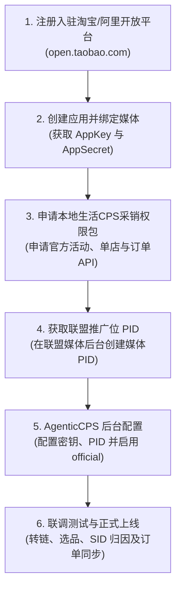
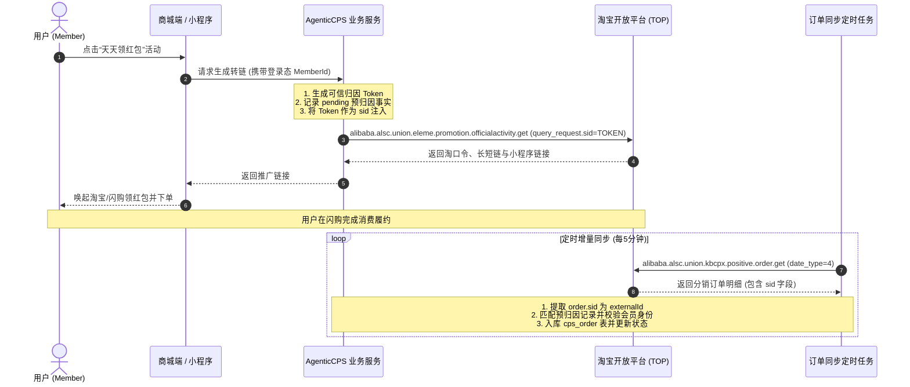

# 淘宝闪购（阿里本地生活）官方 TOP OpenAPI 接入与配置操作指南

本文档依据阿里本地生活 / 淘宝开放平台（TOP OpenAPI）官方接入标准、语雀知识库官方规范以及 AgenticCPS 系统的工程实现编写。涵盖**生态背景与资质要求**、**API 权限开通流程**、**TOP 网关与签名机制**、**核心接口与数据映射**、**SID 会员归因全链路**、**系统后台配置 SOP** 以及**常见问题排查与避坑指南**。

---

## 一、 生态背景与技术架构

### 1. 业务定位
淘宝闪购（阿里本地生活分销业务）涵盖外卖送餐、超市便利、生鲜水果、品牌门店与常驻领券会场。媒体主或开发者接入淘宝闪购联盟后，可通过官方接口完成：
* **官方活动推广**：一键转链生成专属推广短链、长链、淘口令及微信小程序路径（如“天天领红包”、“浏览店铺做任务”等）。
* **导购门店选品与单店推广**：根据城市、类目检索优质外卖与零售商户，生成直达店铺的推广链接。
* **分销订单明细同步**：定时拉取全渠道正向分销订单明细，捕获售中维权、售后退款及反作弊风控状态。
* **高精细会员归因（SID）**：通过链路透传自定义 `sid`，在订单返回时准确提取并沉淀会员返利资产。

### 2. 技术架构总览

```
                     ┌──────────────────────────────────────────────┐
                     │   AgenticCPS 平台适配器 (ElemePlatformClientAdapter) │
                     └───────┬──────────────────────────────┬───────┘
                             │ (主优先)                     │ (容灾备用)
                             ▼                              ▼
              ┌─────────────────────────────┐┌─────────────────────────────┐
              │  ElemeOfficialVendorClient  ││  HdkElemeVendorClient       │
              │  (淘宝闪购官方直连客户端)     ││  (好单库聚合供应商备用)       │
              └──────────────┬──────────────┘└─────────────────────────────┘
                             │ 标准 TOP MD5 字典序签名 (免授权 session 模式)
                             ▼
      ┌─────────────────────────────────────────────────────────────┐
      │  淘宝开放平台 API Gateway (https://eco.taobao.com/router/rest) │
      │  - alibaba.alsc.union.eleme.promotion.officialactivity.get  │
      │  - alibaba.alsc.union.eleme.promotion.storepromotion.get    │
      │  - alibaba.alsc.union.eleme.promotion.storepromotion.query  │
      │  - alibaba.alsc.union.kbcpx.positive.order.get              │
      └─────────────────────────────────────────────────────────────┘
```

---

## 二、 申请入驻与资质准备

根据阿里本地生活与淘宝开放平台规范，申请官方 API 调用权限需完成企业实名认证并具备相应媒体资质：

### 1. 主体资质要求
* **企业法人执照**：支持中国大陆合法注册的企业法人（需三证合一营业执照彩色扫描件，经营范围建议包含软件开发、技术推广或电子商务等）。
* **法定代表人与经办人认证**：法人身份证彩色扫描件、经办人手机号并绑定已实名认证的淘宝个人或企业账号。
* **对公银行账户**：用于佣金提现结算与企业认证对公打款核验。
* **合规税务与发票**：结算需能开具增值税专用发票或普通发票（技术服务费类目）。

### 2. 媒体资产备案要求
* **自有 App**：需国家版权局颁发的《计算机软件著作权登记证书》（软著主体需与企业一致）、主流应用商店在架证明及 App ICP 备案号。
* **微信小程序 / 公众号**：提供微信公众平台企业主体认证后台截图，展示真实的导购、返利或活动落地页面。
* **Web / H5 网站**：需提供企业工信部 ICP 备案证书，且全站启用 HTTPS 安全通信。

---

## 三、 API 权限开通与密钥获取流程



### 步骤 1：创建应用
1. 登录 [淘宝开放平台 (TOP)](https://open.taobao.com/)。
2. 进入【控制台】->【创建应用】，选择行业分类为“本地生活”或“通用工具”。
3. 平台审核通过后，分配 **`AppKey`** 与 **`AppSecret`**。

### 步骤 2：申请本地生活分销 API 权限包
在应用管理中申请开通以下接口权限：
1. `alibaba.alsc.union.eleme.promotion.officialactivity.get`（官方活动推广信息获取）
2. `alibaba.alsc.union.eleme.promotion.storepromotion.get`（单店推广单店铺信息获取与转链）
3. `alibaba.alsc.union.eleme.promotion.storepromotion.query`（单店推广店铺列表筛选）
4. `alibaba.alsc.union.kbcpx.positive.order.get`（媒体推广正向订单明细报表）

### 步骤 3：获取联盟推广位 PID
1. 登录本地生活联盟媒体推广后台。
2. 在【推广管理】->【媒体与推广位】中创建推广位。
3. 获取标准格式的推广位 ID（如 `mm_xxx_xxx_xxx` 或 `alsc_pid`），后续用作系统默认广告位（`defaultAdzoneId`）。

---

## 四、 TOP 网关通信规范与 MD5 字典序签名

### 1. 网关地址与公共参数
* **生产环境网关**：`https://eco.taobao.com/router/rest`
* **预发环境网关**：`http://pre-gw.api.taobao.com/router/rest`
* **请求方式**：`POST`
* **Content-Type**：`application/x-www-form-urlencoded;charset=utf-8`

每次请求必须携带以下 TOP 公共参数：

| 参数名称 | 类型 | 是否必填 | 示例值 | 说明 |
| :--- | :--- | :---: | :--- | :--- |
| `method` | String | 是 | `alibaba.alsc.union.eleme.promotion.officialactivity.get` | TOP API 接口名称 |
| `app_key` | String | 是 | `34891234` | 开放平台分配的 AppKey |
| `timestamp` | String | 是 | `2026-10-28 12:00:00` | 时间戳，格式为 `yyyy-MM-dd HH:mm:ss` |
| `format` | String | 是 | `json` | 响应格式，固定为 `json` |
| `v` | String | 是 | `2.0` | API 协议版本，固定为 `2.0` |
| `sign_method` | String | 是 | `md5` | 签名算法，固定为 `md5` |
| `session` | String | 否 | `""` | 本地生活联盟免授权接口，此参数留空 |
| `sign` | String | 是 | `A3D8FE23...` | 计算得到的 32 位大写 MD5 签名值 |

### 2. MD5 字典序签名算法
AgenticCPS 通过 [`TaobaoTopSigner`](file:///F:/ai/AgenticCPS/backend/qiji-module-cps/qiji-module-cps-biz/src/main/java/com/qiji/cps/module/cps/client/official/eleme/TaobaoTopSigner.java) 类完整实现 TOP 标准签名：
1. **参数排序**：筛选所有请求参数（公共参数 + 业务参数），剔除 `sign` 自身以及值为 `null` 或空字符串的参数。
2. **ASCII 字典序升序**：将所有参数按参数名（Key）升序排列。
3. **首尾拼接 Secret**：将排列好的参数按 `key1value1key2value2...` 格式拼接，并在最前端与最末尾拼接 `AppSecret`。
4. **MD5 与大写输出**：计算该拼接字符串的 UTF-8 字节 MD5 摘要，输出 32 位大写十六进制字符串：
   $$\text{Sign} = \text{MD5}(\text{secret} + k_1 + v_1 + k_2 + v_2 + \dots + \text{secret}).\text{toUpperCase()}$$

---

## 五、 核心接口与数据映射

### 1. 官方常驻活动转链
* **接口**：`alibaba.alsc.union.eleme.promotion.officialactivity.get`
* **核心业务参数**（通过 `query_request` JSON 字符串传递）：
  ```json
  {
    "activity_id": "10144",
    "pid": "mm_100_200_300",
    "sid": "user_trace_sid_uuid"
  }
  ```
* **系统内置官方活动物料清单**：
  | 活动 ID | 活动名称 | 专题类型 | 特点与流量场景 |
  | :--- | :--- | :--- | :--- |
  | `10144` | **淘宝闪购天天领红包** | 外卖闪购 | 全国流量通用、主推首选，用户每日领大额满减红包 |
  | `10174` | **浏览店铺做任务** | 任务领券 | 任务型高转化会场，引导用户浏览指定品牌门店领红包 |
  | `10183` | **零售专属会场** | 超市零售 | 专攻便利店、水果生鲜、超市快消场景，客单价高 |
* **响应解析映射**：
  - `short_url` $\rightarrow$ `CpsPromotionLinkResult.shortUrl`（唤起与推广短链）
  - `click_url` $\rightarrow$ `CpsPromotionLinkResult.longUrl`（落地页长链接）
  - `tb_command` $\rightarrow$ `CpsPromotionLinkResult.tpwd`（淘口令）
  - `wx_app_id` + `wx_path` $\rightarrow$ `CpsPromotionLinkResult.extraFields`（微信小程序跳端凭据）
  - `url_scheme` $\rightarrow$ `CpsPromotionLinkResult.mobileUrl`（App DeepLink）

### 2. 导购单店推广与选品搜索
* **单店转链**：`alibaba.alsc.union.eleme.promotion.storepromotion.get`
  - 入参：`{"shop_id":"E123456","pid":"...","sid":"..."}`
* **单店列表检索**：`alibaba.alsc.union.eleme.promotion.storepromotion.query`
  - 基于游标 `session_id` 实现瀑布流分页拉取。

### 3. 分销正向订单明细同步
* **接口**：`alibaba.alsc.union.kbcpx.positive.order.get`
* **推荐调用参数**：
  - `date_type`: 固定为 `4`（按更新时间筛选，防止丢单或漏掉售后变动）。
  - `biz_unit`: 固定为 `2`（阿里本地生活 CPS 联盟分销）。
  - `order_channel`: `taobao_shangou`（淘宝闪购渠道）。
  - `start_date` / `end_date`: 时间跨度格式 `yyyy-MM-dd HH:mm:ss`。
  - `page_size`: 建议设为 `50` 或 `100`。
  - `pid`: 媒体推广位 PID。
* **订单状态机标准化映射**：

| 官方 order_state | 官方 settle_state | 逆向维权状态 | 系统标准化状态 (platformStatus) | 说明 |
| :---: | :---: | :---: | :---: | :--- |
| `1` | - | - | `0` (PLACED) | 已下单待支付 |
| `2` | `0` | - | `1` (PAID) | 已付款，等待履约配送 |
| `4` | `0` | - | `2` (RECEIVED) | 用户已收货确认 |
| `4` | `1` | - | `3` (SETTLED) | 已结算佣金，满足会员返利到账条件 |
| `0` | - | - | `-1` (INVALID) | 订单失效（超时未付或反作弊风控） |
| `3` 或 `5` | - | 售中/售后维权 | `-1` (INVALID) | 发生退款，标记 `refundTag = 1` |

---

## 六、 SID 会员溯源与自动归因全链路

在 CPS 返利系统中，必须确保用户的领券、下单行为能与系统内部会员账号精准绑定：



> [!IMPORTANT]
> **安全防线说明**：
> 1. 模型对话及工具调用环境严禁接收前端透传的未校验 `memberId`，会员身份由会话上下文（JWT）签发为防篡改 Token。
> 2. `sid` 会员归因记录为只读资产溯源凭据，订单未达到 `SETTLED`（已结算）状态前严禁结算打款至可用余额。

---

## 七、 系统后台接入配置 SOP

### 步骤一：确认数据库基础结构
检查并确认当前数据库结构版本已升级至 `v2.1.10`（若使用全新部署，`cps-all-in-one.sql` 已包含全部配置）：
```bash
python script/update_schema_version.py --status
```
输出应显示：
`cps | v2.1.10 | 2026-10-28 11:35:00 | cps-update.sql | 初始化淘宝闪购联盟官方OpenAPI平台配置与SID会员归因`

### 步骤二：登录 AgenticCPS 管理后台
进入【运营管理】->【CPS 配置】模块：

#### 1. 平台配置（`cps_platform`）
* **路径**：【CPS 平台配置】-> 找到编码为 `eleme` 的记录（名称：**淘宝闪购**）。
* **配置项填写**：
  * **激活供应商 (`active_vendor_code`)**：选择 `official`（官方直连）。
  * **支持的供应商 (`supported_vendors`)**：确保包含 `official,haodanku`。
  * **API Base URL**：`https://eco.taobao.com/router/rest`
  * **默认推广位 ID (`default_adzone_id`)**：填写在阿里本地生活申请的默认 PID（如 `mm_xxx_xxx_xxx`）。
  * **状态**：切换为 **“启用”**。

#### 2. 供应商配置（`cps_api_vendor`）
* **路径**：【CPS 供应商配置】-> 找到供应商编码为 `official`、平台编码为 `eleme` 的记录（**淘宝闪购联盟官方**）。
* **配置项填写**：
  * **AppKey**：填写淘宝开放平台分配的 AppKey（如 `34891234`）。
  * **AppSecret**：填写配套的 AppSecret。
  * **API Base URL**：`https://eco.taobao.com/router/rest`
  * **默认推广位 ID**：填写默认 PID。
  * **额外配置 (`extra_config`)**：可保持默认或自定义网关与接口别名：
    ```json
    {
      "gatewayUrl": "https://eco.taobao.com/router/rest",
      "officialActivityMethod": "alibaba.alsc.union.eleme.promotion.officialactivity.get",
      "storePromotionMethod": "alibaba.alsc.union.eleme.promotion.storepromotion.get",
      "storeQueryMethod": "alibaba.alsc.union.eleme.promotion.storepromotion.query",
      "orderGetMethod": "alibaba.alsc.union.kbcpx.positive.order.get"
    }
    ```
  * **状态**：切换为 **“启用”**。

#### 3. （可选）好单库容灾备用配置
* 找到供应商编码为 `haodanku`、平台编码为 `eleme` 的记录。
* 在 `app_key` 中填入好单库提供的 `apikey`，并将状态设为启用。系统在官方接口调用失败时将自动回退兜底好单库。

### 步骤三：验证与联调
1. **活动转链验证**：进入【CPS 活动运营】->【返利活动广场】，找到“淘宝闪购天天领红包”，点击【一键转链】并填写测试会员账号，验证是否成功生成长短链与淘口令。
2. **订单同步拉取**：在测试环境中触发一次订单手动拉取任务，观察后端日志：
   ```
   [ElemeOfficialVendorClient] 成功同步淘宝闪购官方订单，本次拉取记录数: X 条
   ```

---

## 八、 常见问题排查与避坑指南 (FAQ)

### Q1: 调用接口返回 `code: 15, sub_code: isv.invalid-signature`（签名校验失败）
* **原因分析**：
  1. `AppSecret` 填写错误或混淆了测试环境与生产环境凭证。
  2. 参数参与签名时存在中文未进行 UTF-8 编码，或者在生成 MD5 之前被二次 URL 编码。
  3. 参数未严格按 ASCII 升序排列。
* **排查方式**：
  - 检查 [`TaobaoTopSigner`](file:///F:/ai/AgenticCPS/backend/qiji-module-cps/qiji-module-cps-biz/src/main/java/com/qiji/cps/module/cps/client/official/eleme/TaobaoTopSigner.java) 生成签名字符串时的排序列。
  - TOP 要求签名字符串内部拼接明文参数，不要在待签名串里做 URL-Encode；只有在最后发起 POST 表单提交时才做 URL-Encode。

### Q2: 官方活动转链返回 `biz_code: 50001` 或提示“活动不存在/已下线”
* **原因分析**：
  - `activity_id` 参数错误或活动过期。
* **排查建议**：
  - 淘宝闪购常驻官方活动 ID 请优先使用平台验证通过的物料：`10144`（天天领红包）、`10174`（做任务）及 `10183`（零售会场）。

### Q3: 订单同步返回为空，但实际上已有用户下单
* **原因分析**：
  1. `date_type` 选择了下单时间，而查询时段内未发生新下单；建议切换为 `date_type = 4`（按订单更新时间）。
  2. `biz_unit` 未传或值不等于 `2`。本地生活 CPS 联盟分销报表必须指定 `biz_unit = 2`。
  3. 订单跨越不同推广位 PID；需确认拉取参数中的 `pid` 与转链时传入的 `pid` 一致。

### Q4: 会员返利钱包未自动到账？
* **原因分析**：
  1. 用户下单时未经过带 `sid` 的推广链接进入；
  2. 订单处于 `RECEIVED`（已收货）但尚未到达 `SETTLED`（已结算）状态。根据系统资产安全规范，必须等待商家结算且经过维权退款周期后，平台才会将冻结佣金转入会员可用资产。

---

## 九、 关联代码与测试索引

| 业务角色 / 模块 | 关键类 / 文件路径 |
| :--- | :--- |
| **TOP 字典序签名器** | [`TaobaoTopSigner.java`](file:///F:/ai/AgenticCPS/backend/qiji-module-cps/qiji-module-cps-biz/src/main/java/com/qiji/cps/module/cps/client/official/eleme/TaobaoTopSigner.java) |
| **闪购官方客户端** | [`ElemeOfficialVendorClient.java`](file:///F:/ai/AgenticCPS/backend/qiji-module-cps/qiji-module-cps-biz/src/main/java/com/qiji/cps/module/cps/client/official/eleme/ElemeOfficialVendorClient.java) |
| **平台双向容灾适配器** | [`ElemePlatformClientAdapter.java`](file:///F:/ai/AgenticCPS/backend/qiji-module-cps/qiji-module-cps-biz/src/main/java/com/qiji/cps/module/cps/client/eleme/ElemePlatformClientAdapter.java) |
| **活动中心转链与 SID 生成** | [`CpsRebateActivityServiceImpl.java`](file:///F:/ai/AgenticCPS/backend/qiji-module-cps/qiji-module-cps-biz/src/main/java/com/qiji/cps/module/cps/service/activity/CpsRebateActivityServiceImpl.java) |
| **订单同步与会员归因服务** | [`CpsOrderServiceImpl.java`](file:///F:/ai/AgenticCPS/backend/qiji-module-cps/qiji-module-cps-biz/src/main/java/com/qiji/cps/module/cps/service/order/CpsOrderServiceImpl.java) |
| **全套单元测试与契约** | [`ElemeOfficialVendorClientTest.java`](file:///F:/ai/AgenticCPS/backend/qiji-module-cps/qiji-module-cps-biz/src/test/java/com/qiji/cps/module/cps/client/official/eleme/ElemeOfficialVendorClientTest.java) |
